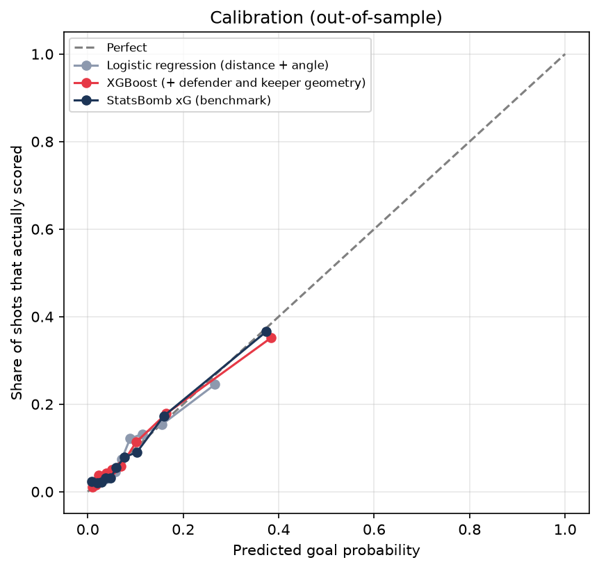

# ⚽ Expected Goals (xG) Model

A machine learning model that predicts the probability that a soccer shot becomes a goal. It is trained on 7,509 shots from six international tournaments and uses the position of every defender and the goalkeeper at the moment of the shot.

**Result: the model recovers 92% of the improvement that StatsBomb's commercial xG model makes over a naive baseline**, using only free data and geometry.


> 🚧 Work in progress. Live demo link goes here once the app is deployed.

## What is xG?

Expected goals (xG) is the probability, from 0 to 1, that a shot scores. A penalty is about 0.76. A shot from 35 yards is about 0.02. Clubs and broadcasters use it to judge chance quality separately from luck and finishing.

## The engineering: features from geometry

A model can't learn much from raw `(x, y)` coordinates. The work is in turning each shot into physically meaningful quantities ([src/features.py](src/features.py)).

**Shot geometry**
- **Distance** to the centre of the goal.
- **Goal angle**: the angle between the two posts as seen from the ball, from `tan θ = |a × b| / (a · b)`. About 37° from the penalty spot, near 0° from the byline.

**Defensive geometry**, from the "freeze frame" of all player positions
- **Open goal fraction** by ray casting: 100 rays are drawn from the ball to evenly spaced points across the goal mouth. A ray is blocked if an opponent's body, modelled as a circle, touches it. The feature is the share of rays that get through.
- **Free angle**: goal angle × open goal fraction.
- **Defenders in the shot cone**: opponents inside the triangle ball / left post / right post.
- **Distance to the nearest defender.**

**Goalkeeper**
- Distance from the keeper to the ball and to the goal centre.
- **Keeper off-line distance**: how far the keeper stands from the line between the ball and the centre of the goal. Zero is perfect positioning.

**Physics-informed constraints.** The XGBoost model is given monotonic constraints that encode what must be true: more distance can never raise the probability, more open goal can never lower it. This stops the model fitting noise in sparse regions of the pitch.

## Results

Scored out-of-sample with 5-fold cross-validation, **grouped by match** so that shots from one match never appear in both training and test data. StatsBomb's own xG is scored on the same shots as a benchmark.

| Model | Log-loss ↓ | Brier ↓ | ROC AUC ↑ |
|---|---|---|---|
| Baseline (always predict the average) | 0.3002 | 0.0811 | 0.489 |
| Logistic regression (distance + angle) | 0.2715 | 0.0754 | 0.731 |
| XGBoost (basic features, no player positions) | 0.2610 | 0.0730 | 0.763 |
| Logistic regression (all features) | 0.2493 | 0.0699 | 0.792 |
| **XGBoost (all features)** | **0.2484** | **0.0698** | **0.794** |
| StatsBomb xG (commercial benchmark) | 0.2442 | 0.0677 | 0.796 |

What this shows:

- **Features matter more than the algorithm.** Adding defender and keeper geometry improves log-loss far more (0.2610 → 0.2484) than switching from logistic regression to XGBoost does (0.2493 → 0.2484).
- **The model is well calibrated.** It predicted 667.3 goals in total; 668 were scored.
- **It agrees with the professionals.** Correlation with StatsBomb's xG is 0.87.
- **A gap remains.** StatsBomb also uses information that is not in the free data, such as the height of the ball at impact.

| Calibration | What the model pays attention to |
|---|---|
|  |  |

Limitations: the XGBoost settings were chosen by trying five configurations on the same cross-validation folds, so its score is slightly optimistic. Players are modelled as static circles; the model does not know which way they are moving.

## Roadmap

- [x] Download shot data from StatsBomb open data
- [x] Draw a shot map
- [x] Engineer features: shot geometry, defender ray casting, goalkeeper position
- [x] Baseline model: logistic regression
- [x] Better model: XGBoost with monotonic constraints
- [x] Evaluate: log-loss, calibration plot, comparison with StatsBomb's xG
- [x] Unit tests for the geometry
- [ ] Interactive Streamlit app: place the ball, defenders and keeper, get the xG
- [ ] Deploy to Hugging Face Spaces
- [ ] Analysis: which players outperformed their xG?

## Run it yourself

Use Python 3.12 to 3.14.

```bash
python -m venv .venv
.venv\Scripts\activate        # macOS/Linux: source .venv/bin/activate
pip install -r requirements.txt

python src/load_data.py       # downloads shots to data/shots.csv (a few minutes)
python src/shot_map.py        # draws the shot map
python src/train.py           # trains and compares the models
python -m pytest              # runs the geometry tests
```

## Project structure

```
src/load_data.py     download and clean the shots
src/features.py      geometry, ray casting and goalkeeper features
src/train.py         train, cross-validate, compare and save models
src/shot_map.py      draw shots on a pitch
tests/               unit tests for the geometry
notebooks/           step-by-step exploration
figures/             saved plots
models/              the trained model
results/             metrics from the last training run
data/                downloaded data (not committed)
```

## Data

[StatsBomb Open Data](https://github.com/statsbomb/open-data), free for public use with attribution. Tournaments: World Cup 2018 and 2022, Euro 2020 and 2024, Copa America 2024, African Cup of Nations 2023.

## Tech

Python, pandas, NumPy, scikit-learn, XGBoost, mplsoccer, pytest, Streamlit
