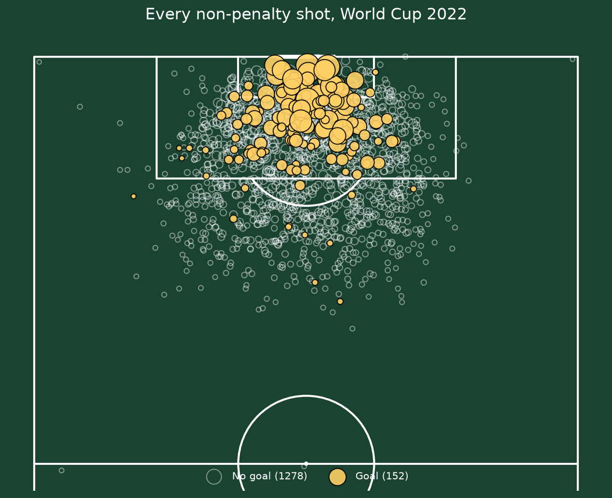
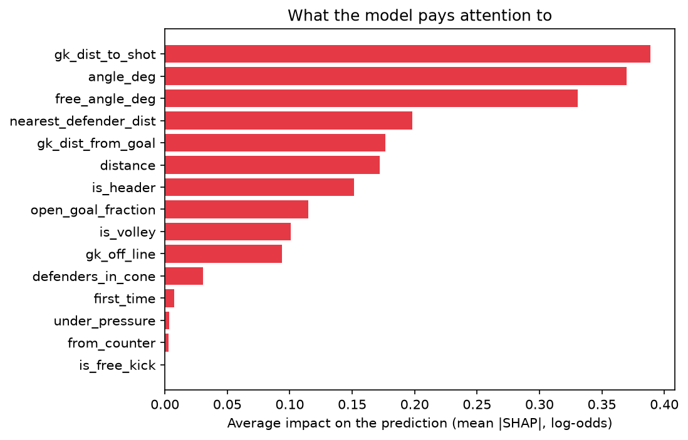

# ⚽ Expected Goals (xG) Model


A machine learning model that predicts the probability that a soccer shot becomes a goal. It is trained on about 45,000 shots from ten competitions and uses the position of every defender and the goalkeeper at the moment of the shot.

**Result: on a held-out tournament the model never saw (the 2022 World Cup), it is statistically indistinguishable from StatsBomb's commercial xG model**, using only free data and geometry.



> 🚧 Live demo link goes here once the app is deployed. Until then, run it locally with `streamlit run app.py`.

## The app

[app.py](app.py) is an interactive explorer. Click on the pitch to move the ball, the goalkeeper and defenders, and the xG updates.

- **Six preset situations**, from a one-on-one to a crowded penalty box.
- **Replay the 2022 World Cup final**: load any of its 27 non-penalty shots with the real player positions, and compare the model's xG with StatsBomb's and with what happened.
- **Ray casting, drawn**: clear paths to goal are shown in yellow, blocked ones are faint.
- **"Why this number?"**: a SHAP chart shows how much each input pushed this prediction up or down.

The deployed model is trained on all the data, so the shots from the final are ones it has seen. The out-of-sample results are in the tables below.

## What is xG?

Expected goals (xG) is the probability, from 0 to 1, that a shot scores. A penalty is about 0.76. A shot from 35 yards is about 0.02. Clubs and broadcasters use it to judge chance quality separately from luck and finishing.

## The engineering: features from geometry

A model can't learn much from raw `(x, y)` coordinates. The work is in turning each shot into physically meaningful quantities ([src/features.py](src/features.py)).

**Shot geometry**
- **Distance** to the centre of the goal.
- **Goal angle**: the angle between the two posts as seen from the ball, from `tan θ = |a × b| / (a · b)`. About 37° from the penalty spot, near 0° from the byline.

**Defensive geometry**, from the "freeze frame" of all player positions
- **Open goal fraction** by ray casting: 100 rays are drawn from the ball to evenly spaced points across the goal mouth. A ray is blocked if an opponent's body, modelled as a circle, touches it. The feature is the share of rays that get through.
- **Free angle**: goal angle × open goal fraction.
- **Defenders in the shot cone**: opponents inside the triangle ball / left post / right post.
- **Distance to the nearest defender.**

**Goalkeeper**
- Distance from the keeper to the ball and to the goal centre.
- **Keeper off-line distance**: how far the keeper stands from the line between the ball and the centre of the goal. Zero is perfect positioning.

**Physics-informed constraints.** The XGBoost model is given monotonic constraints that encode what must be true: more distance can never raise the probability, more open goal can never lower it. This stops the model fitting noise in sparse regions of the pitch.

## How it is evaluated

1. **Held-out test set.** All 1,430 non-penalty shots from the 2022 World Cup are locked away. Nothing is trained or tuned on them.
2. **Cross-validation** on the other 43,567 shots (1,767 matches) to compare models and choose XGBoost's settings from six candidates.
3. **Grouped by match**, so shots from one match never appear in both training and validation data.
4. **Benchmark.** StatsBomb's own xG is scored on the same shots.
5. **Bootstrap confidence intervals** on the test score, re-sampling whole matches 2,000 times.

## Results

### Held-out test: 2022 World Cup

| Model | Log-loss ↓ | Brier ↓ | ROC AUC ↑ |
|---|---|---|---|
| Baseline (always predict the average) | 0.3396 | 0.0952 | 0.500 |
| Logistic regression (distance + angle) | 0.2971 | 0.0858 | 0.757 |
| XGBoost (no player positions) | 0.2824 | 0.0817 | 0.790 |
| Logistic regression (all features) | 0.2659 | 0.0772 | 0.826 |
| **XGBoost (+ defender and keeper positions)**, the final model | **0.2634** | **0.0760** | **0.823** |
| XGBoost (+ goalkeeper kinematics) | 0.2633 | 0.0756 | 0.821 |
| StatsBomb xG (commercial benchmark) | 0.2665 | 0.0762 | 0.815 |

The difference in log-loss between the final model and StatsBomb is −0.003, with a 95% interval of **[−0.011, +0.004]**. The interval includes zero, so the honest claim is "as good as", not "better than". The two models' predictions correlate at 0.92.

### Cross-validation: 43,567 shots

| Model | Log-loss ↓ | Brier ↓ | ROC AUC ↑ |
|---|---|---|---|
| Baseline (always predict the average) | 0.3112 | 0.0850 | 0.494 |
| Logistic regression (distance + angle) | 0.2756 | 0.0775 | 0.746 |
| XGBoost (no player positions) | 0.2614 | 0.0741 | 0.786 |
| Logistic regression (all features) | 0.2493 | 0.0707 | 0.810 |
| **XGBoost (+ defender and keeper positions)** | **0.2461** | **0.0697** | **0.816** |
| XGBoost (+ goalkeeper kinematics) | 0.2467 | 0.0698 | 0.815 |
| StatsBomb xG (commercial benchmark) | 0.2470 | 0.0693 | 0.812 |

### What this shows

- **Features matter more than the algorithm.** Adding player positions improves cross-validated log-loss from 0.2614 to 0.2461. Switching from logistic regression to XGBoost on the same features improves it far less.
- **Data matters too.** With 7,500 shots from international tournaments alone, the same approach scored 0.2484 against StatsBomb's 0.2442 in cross-validation. Six times more data closed that gap.
- **The model is well calibrated.** Predicted probabilities match observed scoring rates across the range (left chart below).

| Calibration | What the model pays attention to |
|---|---|
|  |  |

### A negative result: goalkeeper kinematics

I tested a physics-based model of saves. The ball and the keeper race each other: the ball travels each ray at a fixed speed, and the keeper, after a 0.25 s reaction time, moves at about 5 m/s. A ray is "saveable" if the keeper can reach any point on it before the ball does. This produced two features, the unsaveable fraction of the goal and the resulting scoring window.

They did not help. Cross-validated log-loss was 0.2467 with them and 0.2461 without, so the training script, which picks the final feature set by cross-validation, chose the simpler model. The likely reason is that the keeper's position features already carry the same information, and the kinematic model has fixed speeds and ignores shot height. The code and its unit tests remain in the repository.

### Limitations

- Players are modelled as static circles; the model does not know which way they are moving.
- The geometry is two-dimensional. Shot height is not in the free data.
- The club data is from 2015/16 and the tournament data from 2018 to 2024. StatsBomb's benchmark may have been trained on some of these same shots, which would favour the benchmark, not this model.
- Total xG on the test set was 138.5 against 152 actual goals. StatsBomb's was 137.9, so both models read the 2022 World Cup as a tournament of above-average finishing.

## Roadmap

- [x] Download shot data from StatsBomb open data (ten competitions, 1,831 matches)
- [x] Draw a shot map
- [x] Engineer features: shot geometry, defender ray casting, goalkeeper position
- [x] Baseline model: logistic regression
- [x] Better model: XGBoost with monotonic constraints
- [x] Evaluate: held-out tournament, grouped cross-validation, bootstrap intervals
- [x] Unit tests and continuous integration
- [x] Interactive Streamlit app: place the ball, defenders and keeper, get the xG
- [ ] Deploy to Hugging Face Spaces
- [ ] Analysis: which players outperformed their xG?

## Run it yourself

Use Python 3.12 to 3.14.

```bash
python -m venv .venv
.venv\Scripts\activate        # macOS/Linux: source .venv/bin/activate
pip install -r requirements.txt

python src/load_data.py       # downloads shots to data/shots.csv (a few minutes)
python src/shot_map.py        # draws the shot map
python src/train.py           # tunes, trains and compares the models
python -m pytest              # runs the tests
streamlit run app.py          # opens the app in your browser
```

The app works straight after installing: the trained model and the sample shots are in the repository, so the download and training steps are optional.

## Project structure

```
app.py               the interactive Streamlit app
app_data/            shots from the 2022 World Cup final, for the app
src/load_data.py     download and clean the shots
src/features.py      geometry, ray casting and goalkeeper features
src/train.py         tune, cross-validate, test and save models
src/shot_map.py      draw shots on a pitch
src/make_samples.py  save the World Cup final shots for the app
tests/               unit tests for the geometry, smoke tests for the app
notebooks/           step-by-step exploration
figures/             saved plots
models/              the trained model
results/             metrics from the last training run
data/                downloaded data (not committed)
```

## Data

[StatsBomb Open Data](https://github.com/statsbomb/open-data), free for public use with attribution.

- International: World Cup 2018 and 2022, Euro 2020 and 2024, Copa America 2024, African Cup of Nations 2023.
- Club: complete 2015/16 seasons of the Premier League, La Liga, Serie A and Ligue 1.

Only competitions released in full are used. The free data also contains several hundred Barcelona-only matches, which are left out so the model does not over-learn one team's finishing.

## Tech

Python, pandas, NumPy, scikit-learn, XGBoost, Streamlit, Plotly, mplsoccer, pytest, GitHub Actions
